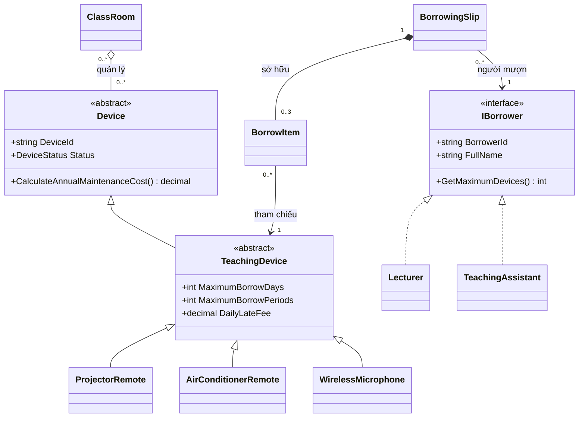

<!-- Mã sinh viên: 202418984 | Họ tên: Ngô Ngọc Thái -->
# Sơ đồ quan hệ lớp

`0..3` là giới hạn lớn nhất của phiếu giảng viên; phiếu trợ giảng có tối đa 2 chi tiết. Một thiết bị có thể xuất hiện trong nhiều chi tiết lịch sử nhưng chỉ có một lần mượn đang hoạt động. Thư viện lớp không áp đặt một thiết bị chỉ thuộc một phòng; ví dụ chạy sử dụng một phòng quản lý thiết bị.

## Hệ phân cấp ngoại lệ

`BorrowingException` kế thừa `Exception`. Các lớp sau kế thừa `BorrowingException`:

| Lớp ngoại lệ | Điều kiện phát sinh |
|---|---|
| DeviceUnavailableException | Thiết bị không sẵn sàng |
| BorrowLimitExceededException | Vượt giới hạn thiết bị trên phiếu |
| InvalidBorrowPeriodException | Ngày hoặc tiết mượn không hợp lệ |
| DuplicateDeviceException | Trùng mã thiết bị |
| DeviceNotInSlipException | Thiết bị không thuộc phiếu |
| DeviceAlreadyReturnedException | Thiết bị đã trả |
| InvalidReturnDateException | Ngày trả trước ngày mượn |
